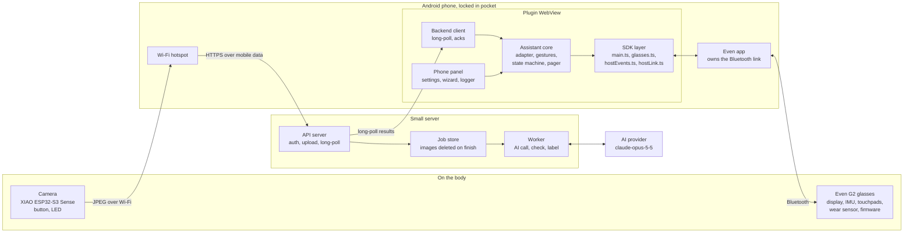
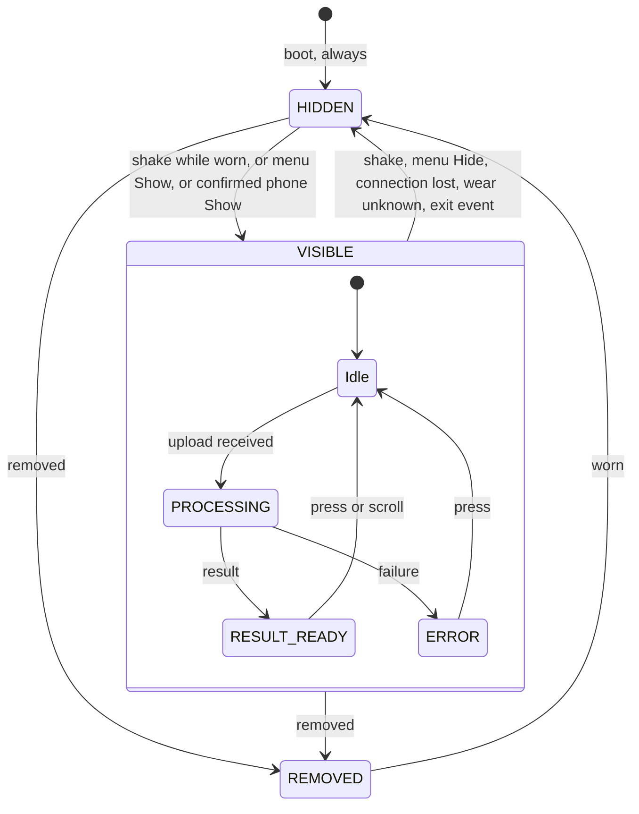
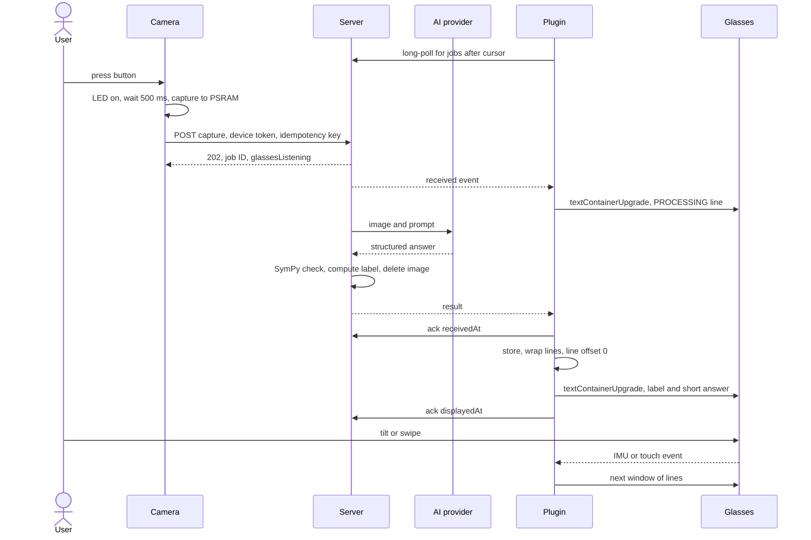
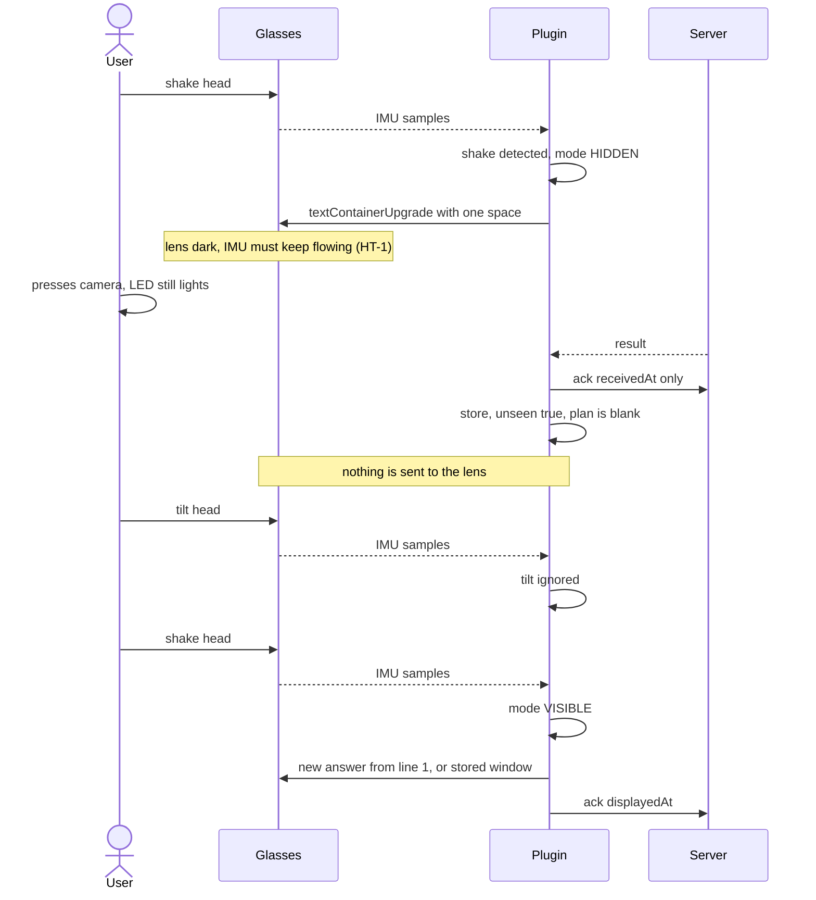
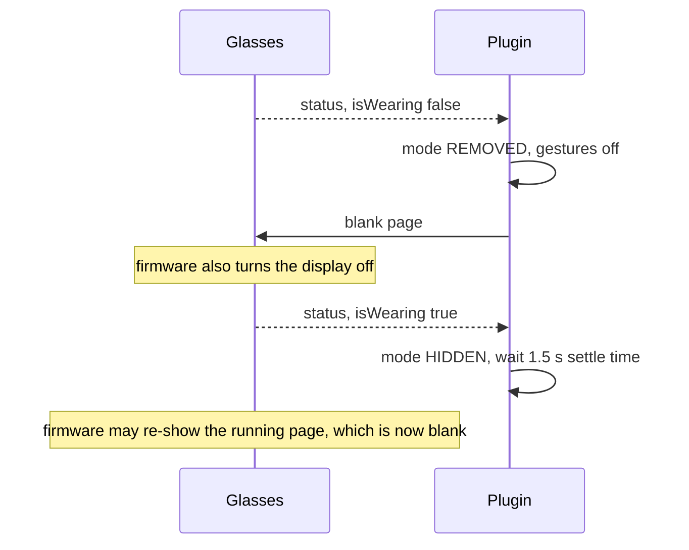
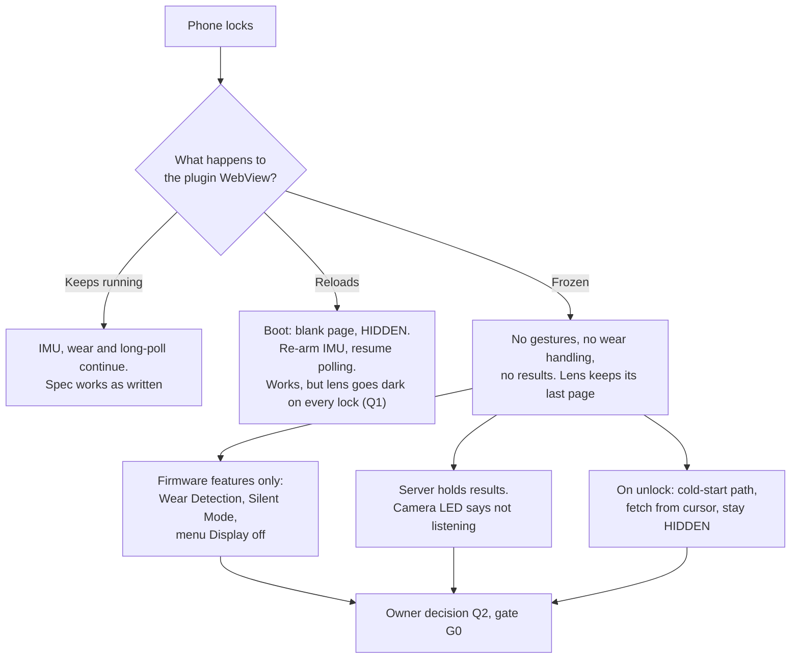
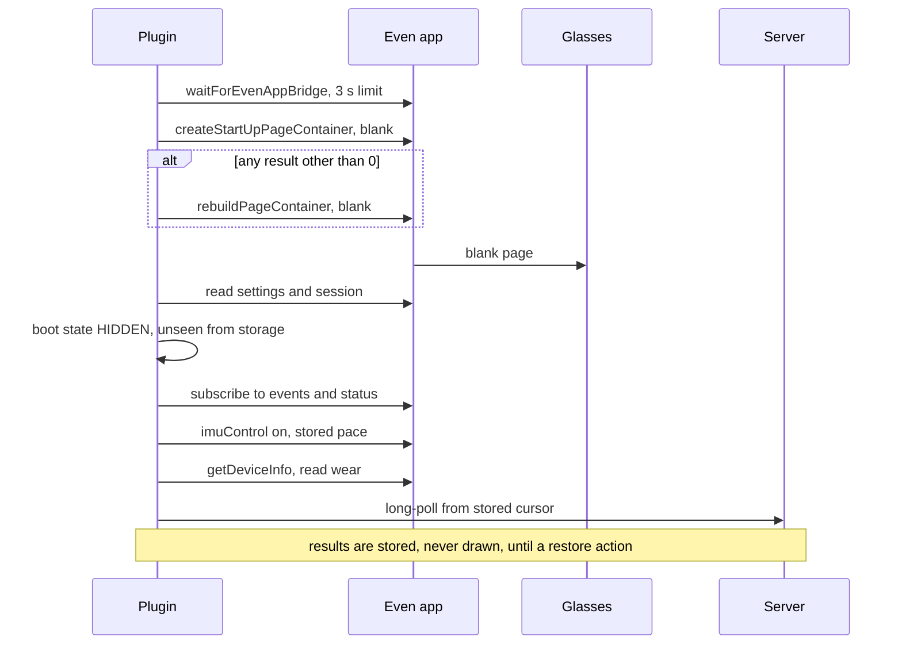

# Architecture

Date: 2026-11-07. This describes the design in [SPEC-V0.3.md](SPEC-V0.3.md). Only the plugin exists today, as a
simulator prototype in `app/`. The backend and camera are designs. Nothing has run on real hardware.

Labels and source keys are as defined in [SDK-APIS.md](SDK-APIS.md). HT numbers point to
[HARDWARE-TESTS.md](HARDWARE-TESTS.md).

## System overview



Three facts shape this design:

- A plugin has no direct Bluetooth. Everything to and from the glasses goes through the Even app. VERIFIED
  D/build/device-apis.
- App logic runs on the phone, so a frozen WebView stops gestures, wear handling and result delivery together.
  VERIFIED D/get-started/architecture. Whether locking freezes it: EXPERIMENT NEEDED (HT-4).
- The camera path does not depend on the plugin. A photo can reach the server while the plugin is frozen, but
  the answer cannot reach the lens.

## Component responsibilities

| Component | Responsible for | Must never | Status |
| --- | --- | --- | --- |
| Camera firmware | Button, LED before capture, one JPEG in PSRAM, upload with retry and idempotency key, LED patterns, deep sleep | Capture without the LED. Video, timed or remote capture. Use the microphone. Write images to flash | Study Lens code compiles, never flashed. Needs changes |
| Phone hotspot | Carry camera traffic to the internet | | Setup step. HT-14 |
| API server | Auth, upload, job records, long-poll, `received` event, `glassesListening` in the upload reply | Send anything to the phone's notification system | Reuse with changes |
| Worker | Call the AI, run the SymPy check, compute the label, delete the image | Let the model write the label. Log answer text | Reuse with changes |
| AI provider | Read the photo and explain it | Hold the API key anywhere except the server | Behind `SolveProvider` |
| Even app (host) | Bluetooth link, WebView, storage, contextual menu, notification forwarding | Not ours to change | Third party |
| Glasses firmware | Render pages, report IMU, touch and wear. Wear Detection, HeadUp, Silent Mode | Not ours to change | Third party |
| SDK layer (`main.ts`, `glasses.ts`, `hostEvents.ts`, `hostLink.ts`) | Translate SDK events to app inputs and display plans to bridge calls. Start, retry and stop the IMU. Clean up on exit | Hold state logic. `hostLink.ts` takes a small bridge interface, so it is tested in Node | Built |
| Bridge lane (`bridgeLane.ts`) | Run every bridge call one at a time with a 2.5 s limit, display calls first | Let two bridge calls run together | Built |
| IMU adapter (`imuAdapter.ts`) | Raw `{x,y,z}` to pitch and yaw signals, using stored axis, sign, scale, mode. Measure rate | Assume any unit or rate | Built |
| Gesture engine (`gestureEngine.ts`, `shakeDetector.ts`) | Recognise shake and tilt. Shake wins | Run when wear is not `worn` | Built, thresholds synthetic |
| State machine (`stateMachine.ts`) | Pure `mode`, `job`, `wear` transitions | Store `mode`. Reveal on anything but a restore action | Built |
| Pager (`paging.ts`) | Wrap with firmware font metrics, own the line offset | Rely on firmware scroll | Built |
| Render queue (`renderQueue.ts`) | One display update at a time, keep newest plan only, retry a failed blank | Let a hide queue behind older updates. It can still wait up to about 2.5 s for one call already in flight | Built |
| Storage (`storage.ts`, `settings.ts`) | Settings, last answer, line offset, `unseen`, debounced writes | Store Visible or Hidden | Built |
| Assistant (`assistant.ts`) | Connect the parts. `plan()` is the single decision on what the lens shows | | Built |
| Backend client | Long-poll, backoff, cursor, split acks. Hand results to the Assistant | Draw directly on the lens | Not built. Reuse SL `client.ts` |
| Phone panel (`panel.ts`, `index.html`) | Status, settings, calibration wizard, raw logger, phone `Show` | Show answer text | Built, except `Show` and the setup checklist |

## The reveal rule

Only the plugin can put app content on the lens, and only through `plan()`:

```text
plan():  if mode is not VISIBLE  -> blank
         else                    -> header + current window of lines
```

Every display change goes through this one function. A new result, a reconnect or a restart can change what
is stored, but cannot change `mode`. The server has no path to the lens except through this check, and V1 has no
notification service, so the Study Lens bypass is gone.

## State model



The job also runs while HIDDEN or REMOVED, but nothing is drawn. The result is stored with `unseen` set, and
appears on the next restore.

## Data flow 1: capture to lens

Normal case: plugin running, state VISIBLE. All timings are ASSUMPTION (budget in
[CAMERA-AND-BACKEND.md](CAMERA-AND-BACKEND.md) section 8).



What each hop carries:

| Hop | Data | Protection |
| --- | --- | --- |
| Camera to server | JPEG, device ID, key | TLS with pinned root, device token bound to the ID, rate limit |
| Server to AI provider | JPEG, prompt | TLS. Retention under the provider's terms, [S26] |
| Server to plugin | Answer text | TLS, client token, whitelisted origin, CORS |
| Plugin to glasses | One screen of text | Host's Bluetooth link |
| Storage on phone | Last answer, offset, settings | `setLocalStorage`. No secrets in the repo |

Failure handling:

| Failure | Result |
| --- | --- |
| Upload fails | Camera retries with the same key, then drops the photo and shows the failure LED pattern |
| Duplicate upload | Server returns the original job |
| AI fails | Job marked failed, image deleted, ERROR reaches the plugin |
| Photo unreadable | `RETAKE: <hint>` as the answer |
| Plugin not polling | `glassesListening: false`, camera shows its LED pattern, result waits on the server |

## Data flow 2: Hidden mode



Removal and re-wear:



This is safe only because the blank reached the glasses before re-wear. If the plugin was frozen at removal,
the firmware may bring back the old page. VERIFIED SUP/wear for active features, with Translate as the example.
Plugin pages and the frozen case are HT-6.

Things outside this flow that can still light the lens are listed in SPEC section 8.

## Data flow 3: locked phone

Which branch is real is unknown until HT-4.



Cold-start sequence, used for every launch and reload:



The blank page is sent before storage is read, so a hung storage call cannot leave an old page on the lens.
Mode is never read from storage. VERIFIED `app/src/main.ts`, `app/src/core/stateMachine.ts`. The server step is
not built. If the bridge takes longer than 3 s to appear, the app gives up and stays a dead page until a reload.
VERIFIED `app/src/main.ts`.

## Time and timers

- Timestamps are wall-clock arrival times, so a suspension appears as a jump in the log. VERIFIED `app/src/main.ts`.
  Deadlines inside the Assistant use a clock that never runs backwards, so a phone clock change cannot block
  recovery. VERIFIED `app/src/core/assistant.ts`.
- Sample rate is measured from arrivals, never assumed. VERIFIED `app/src/core/imuAdapter.ts`.
- `setInterval` may stall in the background. ASSUMPTION GH#16. Gesture logic runs on sample arrival. The 1-second
  tick drives sensor-lost detection, storage writes, the retry of a failed blank and the IMU retry. The time limits
  on bridge calls are timers too. VERIFIED `app/src/main.ts`, `app/src/core/bridgeLane.ts`.

## Boundaries that keep it testable

`app/src/core/` has no SDK package imports. Clock, storage and display are injected, so the same code runs in Node tests
and in the WebView. Real IMU logs from Phase 0 can be replayed through the same path once a replay tool exists
(see [PLAN.md](PLAN.md), Phase 1).
